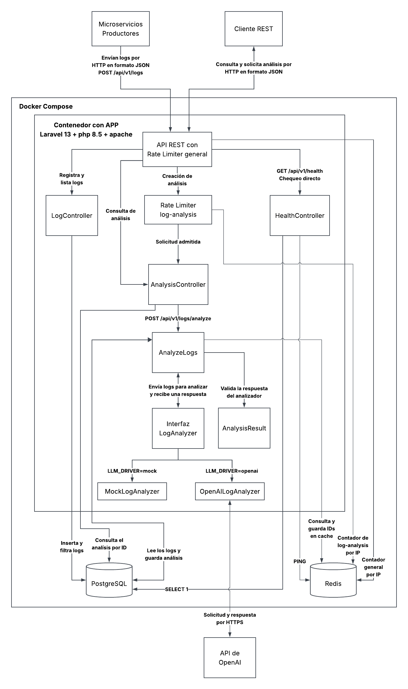
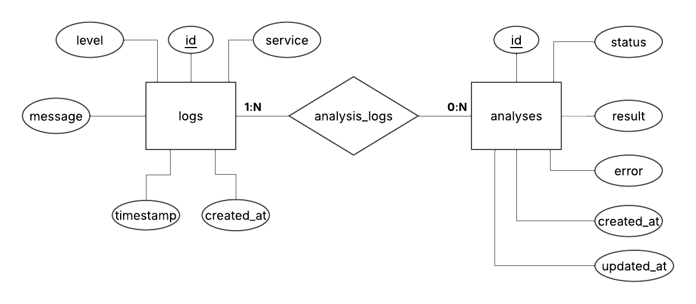
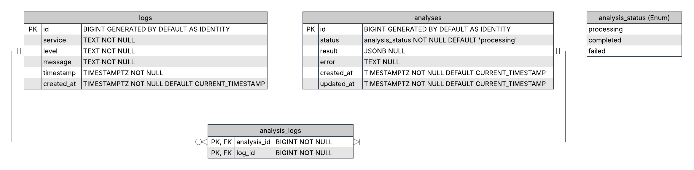

# Arquitectura de SmartLog Analyzer

SmartLog Analyzer es una API que recibe logs de varios microservicios. Permite filtrarlos y pedir un análisis de los logs elegidos. Las rutas usan el prefijo `/api/v1`. La aplicación se puede levantar con Docker Compose y probar con datos de ejemplo.

## Diagrama de arquitectura



- Apache recibe las solicitudes y sirve Laravel desde `public/`.
- Laravel utiliza Eloquent para comunicarse con PostgreSQL, ambos se encuentran dentro de la red de Docker Compose.
- Laravel usa Redis como caché general y para guardar los contadores de ambos límites. `AnalyzeLogs` usa la caché para reutilizar análisis completados.
- El adaptador OpenAILogAnalyzer se conecta por HTTPS a la API de OpenAI.
- El cliente REST y los microservicios que envían logs están fuera de Compose.

## Flujo de datos

1. **Guardar y consultar logs.** `POST /api/v1/logs` valida y guarda cada log. `GET /api/v1/logs` permite filtrar por servicio, nivel y rango de fechas. La respuesta incluye `logs` con el listado y `summary` con los conteos por servicio y nivel.
2. **Validar el pedido y buscar un análisis previo.** `POST /api/v1/logs/analyze` pasa por el límite general y por `throttle:log-analysis` antes de llegar a `AnalysisController`. La API valida los IDs elegidos y el parámetro `cache`. `AnalyzeLogs` comprueba que todos los logs existan y, si el pedido admite reutilización, consulta Redis. Si encuentra una referencia válida, la API devuelve `200 OK` con el ID existente.
3. **Generar y guardar un análisis nuevo.** Cuando se necesita generar, `AnalyzeLogs` usa SQL para contar los logs por servicio y nivel. En una transacción corta crea el análisis en estado `processing` y guarda en `analysis_logs` sus relaciones con los logs seleccionados. Al terminar la transacción, envía los logs y los conteos al analizador configurado con `LLM_DRIVER`. `AnalysisResult` comprueba que la respuesta incluya `summary`, `categories` y `suggestions`. Si la respuesta es válida, `AnalyzeLogs` guarda el resultado en estado `completed` en PostgreSQL y después publica su ID en Redis. La API responde `201 Created` con el ID nuevo.
4. **Consultar el análisis y comprobar la API.** `GET /api/v1/analysis/{id}` devuelve el estado del análisis y el resultado o error guardado. `GET /api/v1/health` comprueba PostgreSQL con `SELECT 1` y Redis con `PING`. Devuelve `200 OK` si ambos responden y `503 Service Unavailable` si falla alguno.

### Autenticación con clave de API

Las rutas de logs, análisis y `/health` piden una clave compartida. El servidor recibe una clave larga y aleatoria mediante `SMARTLOG_API_KEY`. En `.env.example` se declara `SMARTLOG_API_KEY=`.

Los microservicios y el cliente REST envían la clave en el encabezado `Authorization`.

```http
Authorization: Bearer <clave>
```

| Ruta | Controles en orden |
| --- | --- |
| `POST /api/v1/logs`, `GET /api/v1/logs` y `GET /api/v1/analysis/{id}` | Límite general por IP y validación de la clave. |
| `POST /api/v1/logs/analyze` | Límite general por IP, validación de la clave y límite adicional `log-analysis`. |
| `GET /api/v1/health` | Comprueba la clave y después revisa si PostgreSQL y Redis responden. |

El límite general cuenta también los intentos con una clave incorrecta. El middleware de autenticación exige que `SMARTLOG_API_KEY` esté configurada y compara la clave recibida con `hash_equals`.

### Límites de solicitudes

Cada IP tiene un máximo de pedidos por minuto para el conjunto de rutas de logs y análisis. `POST /api/v1/logs/analyze` también pasa por `log-analysis`, que tiene un máximo menor. Cada pedido de análisis aceptado cuenta para los dos límites, incluso si usa un resultado de Redis o incluye `?cache=false`.

Los dos máximos se pueden configurar y las reglas se registran en `AppServiceProvider`. Laravel usa Redis como caché general con `CACHE_STORE=redis`. El valor `redis` en `cache.limiter` indica dónde guardar los contadores por IP.

El límite general se aplica a las rutas de logs y análisis. Para entrar a `/health`, Laravel comprueba la clave que tiene configurada. Así puede devolver `503` si Redis está caído.

### Reutilización de análisis con Redis

Si pedís analizar los mismos logs, la API puede usar un análisis que ya terminó. **Redis guarda su ID durante un tiempo configurable. PostgreSQL guarda el resultado completo y el historial.**

| Pedido | Qué hace la API |
| --- | --- |
| `cache=true` o sin el parámetro, y hay un análisis disponible | Devuelve `200 OK` con el ID del análisis anterior. |
| `cache=true` o sin el parámetro, y no hay un análisis disponible | Genera uno nuevo y devuelve `201 Created` con su ID. |
| `POST /api/v1/logs/analyze?cache=false` | Pide generar un análisis nuevo aunque exista uno anterior. Si termina bien, devuelve `201 Created` y actualiza Redis con el nuevo ID. |

Para reconocer un pedido repetido, la API compara los **IDs de los logs** y la **configuración del analizador**. El orden no cambia la selección, los IDs repetidos se rechazan. Por ejemplo, `[5, 12]` y `[12, 5]` representan la misma selección.

Si dos pedidos necesitan generar el mismo análisis al mismo tiempo, Redis usa un bloqueo temporal para que solo uno lo genere. Al tomar el bloqueo, la API vuelve a buscar en la caché si el pedido permite reutilizar un resultado. Si otro pedido ya está generando ese análisis, la API devuelve `409 Conflict` y el cliente puede reintentar.

## Modelo de datos

### Modelo entidad-relación (MER)



- `1:N` junto a `logs` indica que cada análisis usa uno o más logs. 
- `0:N` junto a `analyses` indica que un log puede participar en cero o más análisis.

### Modelo físico en PostgreSQL



- En `analysis_logs`, `analysis_id` apunta a `analyses.id` y `log_id` apunta a `logs.id`.
- Los dos IDs forman la clave primaria compuesta.
- La API valida que haya al menos un log por análisis antes de guardar el análisis y sus relaciones.

### Atributos de las tablas

#### `logs`

| Atributo | Qué guarda |
| --- | --- |
| `id` | Identificador único del log. Es la clave primaria. |
| `service` | Nombre del microservicio que generó el log. |
| `level` | Nivel del log, como `INFO`, `WARN` o `ERROR`. |
| `message` | Texto que describe el evento reportado por el microservicio. |
| `timestamp` | Fecha y hora en que ocurrió el evento, según el microservicio que lo envió. |
| `created_at` | Fecha y hora en que SmartLog Analyzer guardó el log. |

#### `analyses`

| Atributo | Qué guarda |
| --- | --- |
| `id` | Identificador único del análisis. Es la clave primaria y se usa para consultarlo por la API. |
| `status` | Estado del análisis. `processing` indica que está en curso, `completed` que terminó con un resultado válido y `failed` que falló. |
| `result` | Resultado validado del analizador, guardado como `jsonb` con el resumen, las categorías y las sugerencias. |
| `error` | Motivo de la falla cuando el análisis pasa a `failed`. |
| `created_at` | Fecha y hora en que la API creó el análisis, antes de llamar al analizador. |
| `updated_at` | Fecha y hora del último cambio del análisis, como el paso a `completed` o `failed`. |

#### `analysis_logs`

| Atributo | Qué guarda |
| --- | --- |
| `analysis_id` | ID del análisis. Es una clave foránea que apunta a `analyses.id`. |
| `log_id` | ID del log seleccionado. Es una clave foránea que apunta a `logs.id`. |

## Decisiones técnicas

| Decisión | Otra opción | Por qué se eligió |
| --- | --- | --- |
| Laravel 13 con PHP 8.5 | Node.js con Fastify | Fastify ofrece validación con JSON Schema y herramientas para probar endpoints. Laravel reúne la validación y las pruebas HTTP con Eloquent y migraciones, lo que reduce el trabajo de integrar esas piezas en el proyecto. |
| Imagen `php:8.5-apache` para el contenedor `app` | Nginx y PHP-FPM en contenedores separados | Apache recibe las solicitudes y ejecuta PHP dentro de `app`. Docker Compose levanta la aplicación, PostgreSQL y Redis. |
| PostgreSQL (SQL) | MongoDB (NoSQL) | Se eligió PostgreSQL para que la base compruebe con claves foráneas que cada relación de analysis_logs apunte a un análisis y a un log existentes. Así queda registrado qué logs se usaron en cada análisis, incluso cuando un mismo log se usa en varios. En el modelo con MongoDB, los IDs se guardarían en el documento del análisis y la aplicación tendría que mantener esas referencias válidas. |
| Versionado en la URL con `/api/v1` | Usar rutas sin prefijo de versión | El prefijo identifica qué versión del contrato usa el cliente y permite publicar otra versión en paralelo si es necesario. |
| Elegir los logs por ID | Enviar filtros al endpoint de análisis | El cliente revisa el listado y elige los logs que quiere analizar. Con filtros, los logs que coinciden pueden cambiar entre la consulta y el pedido de análisis. |
| Resultado del análisis en `analyses.result` (`jsonb`) | Tablas separadas para categorías y sugerencias | Al consultar un análisis, el cliente recibe el resumen, las categorías y las sugerencias juntos. Por eso se guardan en una sola columna. Con tablas separadas, habría que reunir esos datos para devolver el resultado completo. |
| Análisis síncrono | Cola con un worker de Laravel | Cuando se genera un análisis nuevo, la API espera al analizador configurado y devuelve `201 Created` con el ID. Si reutiliza un análisis anterior, devuelve `200 OK` con el ID existente. Si la generación se acerca con frecuencia al límite de tiempo de la solicitud, se evaluará usar una cola. |
| Redis para reutilizar análisis | Ejecutar el analizador en cada solicitud | Los pedidos equivalentes pueden reutilizar un análisis completado y evitar otra llamada al LLM. Redis guarda el ID y PostgreSQL guarda el resultado completo. |
| Límite general por IP y límite adicional para análisis | Aplicar un solo límite a todos los pedidos | El límite general controla el tráfico de logs y análisis. El límite adicional tiene un máximo menor porque un pedido de análisis puede llamar al LLM. Redis guarda los contadores de las dos reglas. |
| Adaptador de OpenAI y mock con la interfaz `LogAnalyzer` | Llamar a OpenAI directamente desde `AnalyzeLogs` | `AnalyzeLogs` depende de `LogAnalyzer`, siguiendo el principio de inversión de dependencias. `LLM_DRIVER` selecciona la implementación. Compose arranca con el mock para probar la aplicación sin credenciales de OpenAI y `LLM_DRIVER=openai` activa la integración real. Para sumar otro proveedor, se implementa la interfaz y se registra el adaptador. Las respuestas pasan por la misma validación. |
| Guardar el estado de cada análisis creado | Guardar solo los análisis exitosos | La API permite consultar por ID el estado y el resultado o error. Los logs elegidos quedan relacionados en `analysis_logs`, incluso si el análisis falla. |
| Clave compartida `SMARTLOG_API_KEY` | Dejar las rutas abiertas | Solo pueden usar la API los clientes que tienen la clave. Todos los que la tienen pueden acceder a las mismas rutas. |

## Estructura del proyecto

El desafío pide `src/` para el código fuente y `db/` para las migraciones y los seeders. Se ajustaron los directorios que usan Laravel y Composer para seguir esa estructura.

## Fallos previstos

- Si una IP supera cualquiera de los dos límites, la API devuelve `429 Too Many Requests`.
- Si falta la clave o el valor recibido es incorrecto, el middleware de autenticación devuelve `401 Unauthorized`.
- Si la selección de logs o el valor de `cache` son inválidos, la API devuelve `422 Unprocessable Entity`.
- Si se necesita generar un análisis y ya hay uno igual en curso, la API devuelve `409 Conflict`. El cliente puede reintentar.
- Si Redis falla al comprobar los límites, consultar la caché o tomar el bloqueo antes de generar, la API devuelve `503 Service Unavailable`.
- Si el análisis ya se guardó en PostgreSQL y falla la escritura de su ID en Redis, la API devuelve `201 Created` con el ID guardado.
- Si el analizador devuelve un formato inesperado, la API responde `502 Bad Gateway`. Si se agota el tiempo de espera, responde `504 Gateway Timeout`. En ambos casos guarda el estado `failed` y devuelve el ID del análisis.
